# 🎟️ EVENTLY - Digital Guest & Event Management System

> **⚠️ Catatan Portofolio:** Repositori ini merupakan *showcase* untuk proyek *Project Based Learning (PBL)* Politeknik Negeri Malang. Karena alasan privasi data dan kepemilikan kode sumber secara kolektif, *source code* utama berada pada repositori privat.

**EVENTLY** adalah Sistem Informasi Manajemen Tamu Undangan Digital komprehensif berbasis web (MVC) yang dirancang untuk menggantikan sistem buku tamu manual. Platform ini mengintegrasikan pencatatan kehadiran *real-time* menggunakan *Smart QR Code Scanner*, manajemen distribusi suvenir (*anti-duplicate*), dan sistem *broadcast* undangan digital otomatis melalui WhatsApp.

---

## 👨‍💻 Peran & Kontribusi Saya (Mochamad Reza Firdaus)
Dalam proyek ini, saya berperan sebagai **UI/UX Designer & Frontend Focus Developer**. Tanggung jawab dan pencapaian teknis saya meliputi:

* 🎨 **UI/UX Redesign:** Merancang *wireframe* dan *mockup high-fidelity* di Figma, serta melakukan *refactoring* total komponen *Landing Page* untuk interaktivitas tingkat lanjut.
* 📱 **Pengembangan Frontend Scanner (Smart Check-In):** Mengembangkan antarmuka responsif untuk halaman panel Petugas/Scanner di lapangan yang dapat beroperasi lancar di perangkat seluler, serta melakukan *consuming API* data backend ke komponen visual *frontend*.
* 🖥️ **Theming Dashboard Superadmin:** Membangun *User Interface* dasbor pusat kendali Superadmin dengan mengimplementasikan pendekatan desain *Classic Theme* yang elegan dan ergonomis untuk kemudahan navigasi pengelolaan data berskala besar.
* 📖 **Penyusunan Dokumentasi Visual:** Menyusun dokumen manual penggunaan aplikasi (*User Guide*) dan dokumentasi aset visual sistem secara terstruktur.

---

## 📸 Galeri & Antarmuka Sistem (UI/UX)
*Berikut adalah cuplikan antarmuka EVENTLY hasil rancangan dan implementasi frontend saya:*

  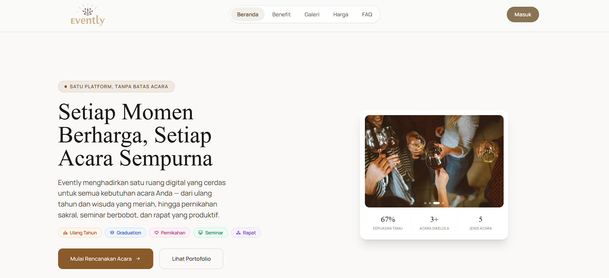
  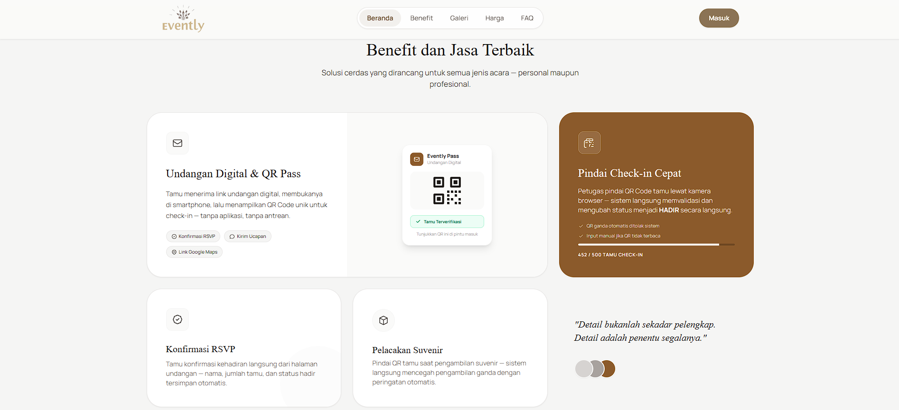

 

  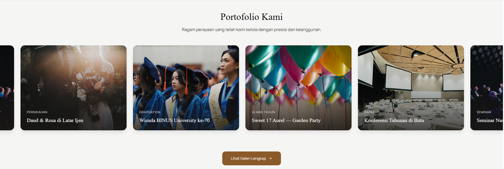
  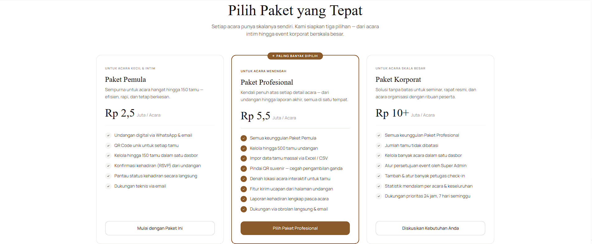

 

  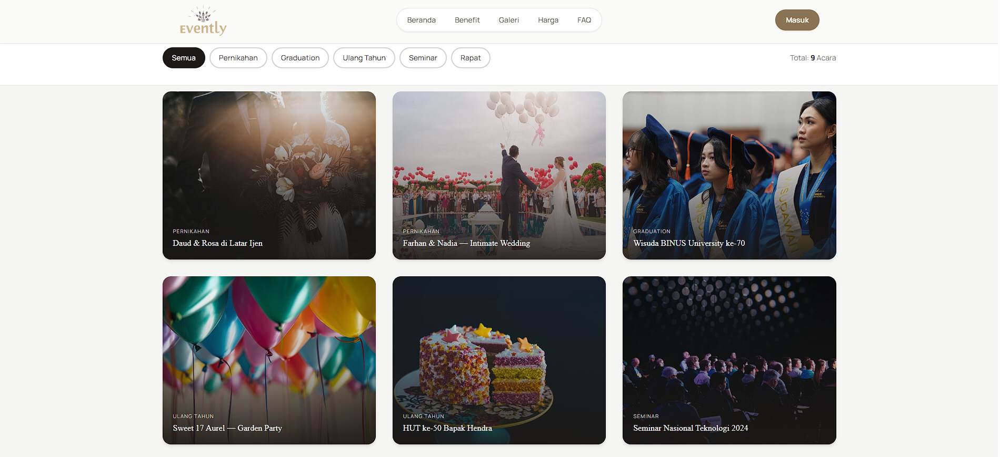
  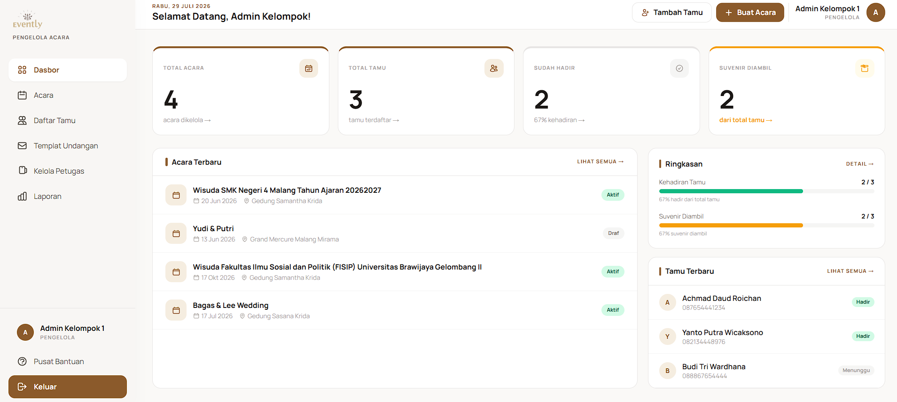

 

  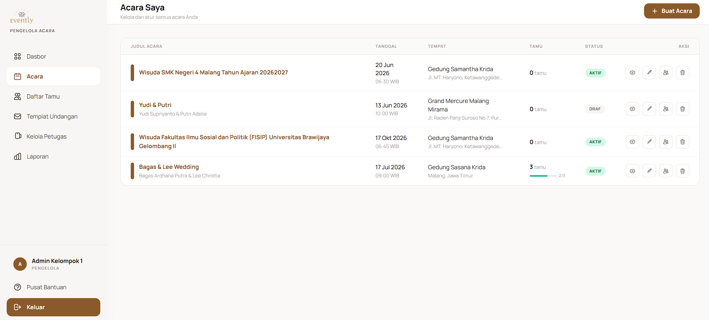
  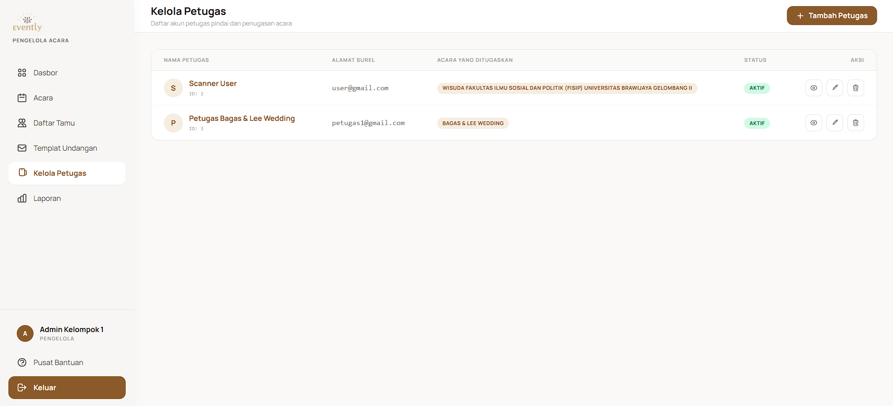

 

  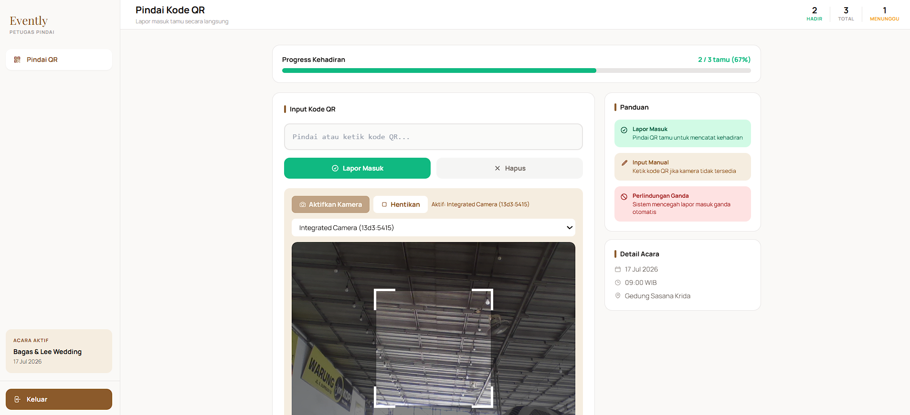
  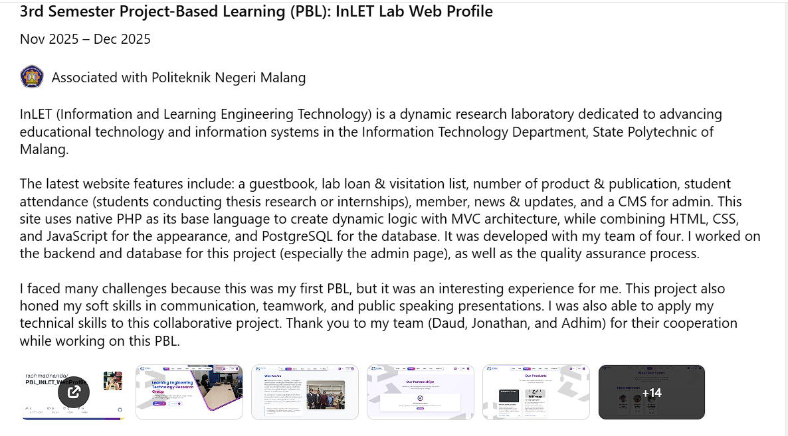

 

  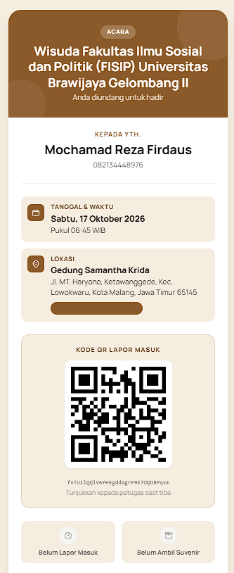

*(Catatan: Gambar dapat diperbesar dengan mengeklik tautan pada repositori).*

---

## 🚀 Fitur Utama & Role-Based Access Control (RBAC)

Sistem ini membagi fungsionalitas berdasarkan 4 tingkat pengguna:

1. 👑 **Super Admin:** Mengontrol *Approval System* untuk menyetujui/menolak pengajuan acara baru, mengelola akun Admin/Scanner, dan memantau analitik data global.
2. 👔 **Admin (Penyelenggara):** Memiliki akses untuk memanajemen acara, *import* data tamu massal via Excel/CSV, *generate* QR Code unik otomatis, membuat *template* undangan, mengirim *WhatsApp Blast*, dan mengunduh laporan kehadiran (*Export to Excel/CSV*).
3. 📸 **Scanner (Petugas Lapangan):** Menggunakan fitur *Smart Check-In* melalui kamera peramban (*HTML5-QRCode*). Sistem ini mengidentifikasi QR tamu secara instan, mencatat kehadiran *real-time*, dan mengunci status distribusi suvenir agar tidak terjadi klaim ganda.
4. 💌 **Tamu Undangan:** Menerima undangan unik via WhatsApp, mengisi form RSVP digital, melihat peta lokasi acara (terintegrasi Google Maps), dan mengirim ucapan digital ke *Wishlist Wall*.

---

## 🛠️ Arsitektur & Tech Stack

Platform ini dibangun dengan memperhatikan skalabilitas, keamanan data, dan performa tinggi (menghindari *latency* dan *race condition*).

* **Backend & Framework:** PHP 8.2, Laravel 10 (Arsitektur MVC)
* **Frontend & Styling:** HTML5, JavaScript, Tailwind CSS, Blade Templating
* **Database & Infrastruktur:** PostgreSQL dengan *Database Transaction* dan *Pessimistic Locking* (`lockForUpdate()`) untuk mencegah duplikasi *check-in* saat multi-scanner beroperasi bersamaan.
* **Integrasi API Eksternal:**
  * **WhatsApp Gateway:** Menggunakan **Venom Core API (Puppeteer/Node.js)** terintegrasi dengan Laravel Queue untuk *asynchronous message broadcasting*.
  * **Smart Scanner:** Implementasi `HTML5-QRCode` library untuk optimasi *framerate* kamera perangkat seluler klien secara langsung melalui *browser*.
  * **Maps:** Google Maps API Embed.
* **Keamanan:** Kriptografi sandi *Bcrypt*, proteksi sesi aplikasi, *Middleware* RBAC, dan form request validation.

---

## 👥 Tim Pengembang (Kelompok 1 TI-2F - Politeknik Negeri Malang)
Sistem ini dikembangkan secara kolaboratif bersama tim hebat:
1. **Achmad Daud Roichan** - *Backend Lead & Notification Engineer*
2. **Mochamad Reza Firdaus** - *UI/UX Designer & Frontend Focus Developer*
3. **Nur Alfiyanti** - *System Analyst & Full-Stack Core Developer*
4. **Rachmad Febriananda** - *Database Administrator & Smart Check-In Engineer*
